# Mentor Slot Booking System - Design Diagrams

## High-Level Design (HLD)

### System Architecture
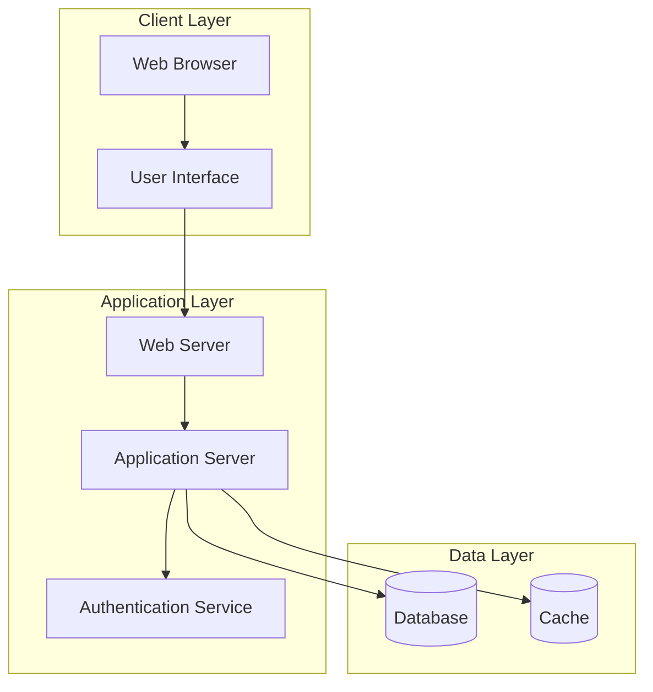

### Component Interaction
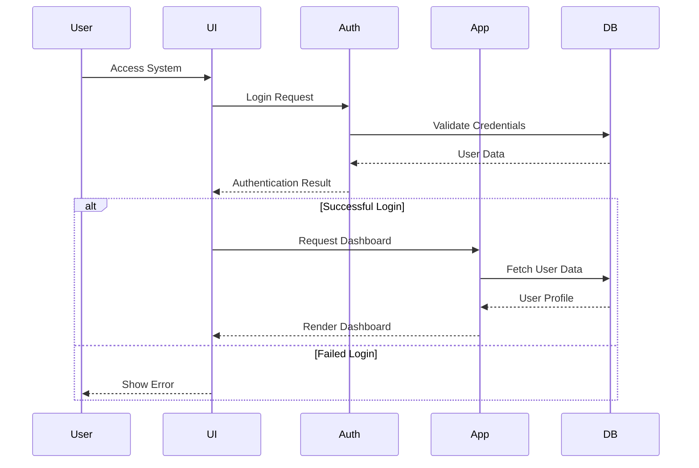

### Data Flow
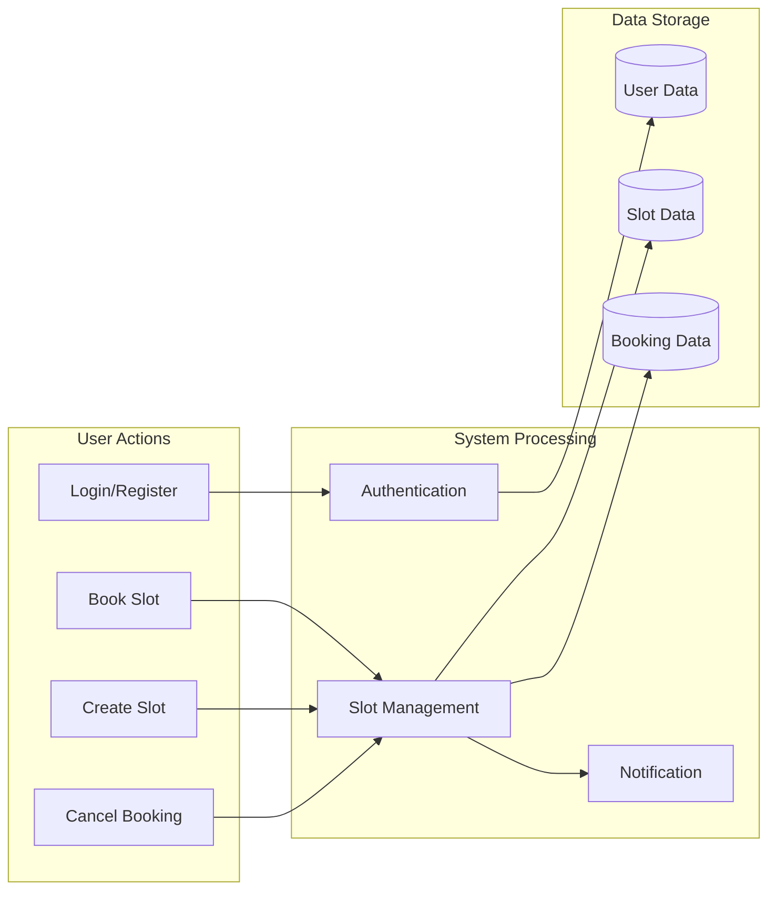

## Low-Level Design (LLD)

### Database Schema
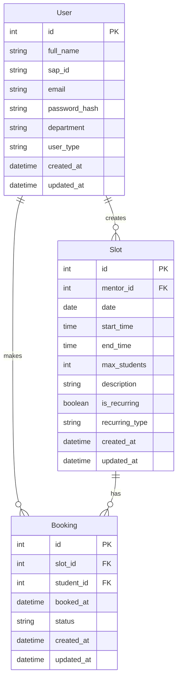

### Class Diagram
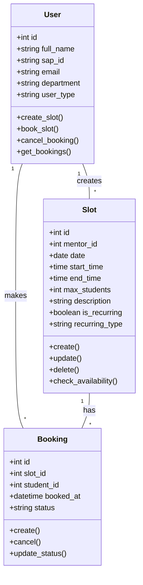

### API Endpoints
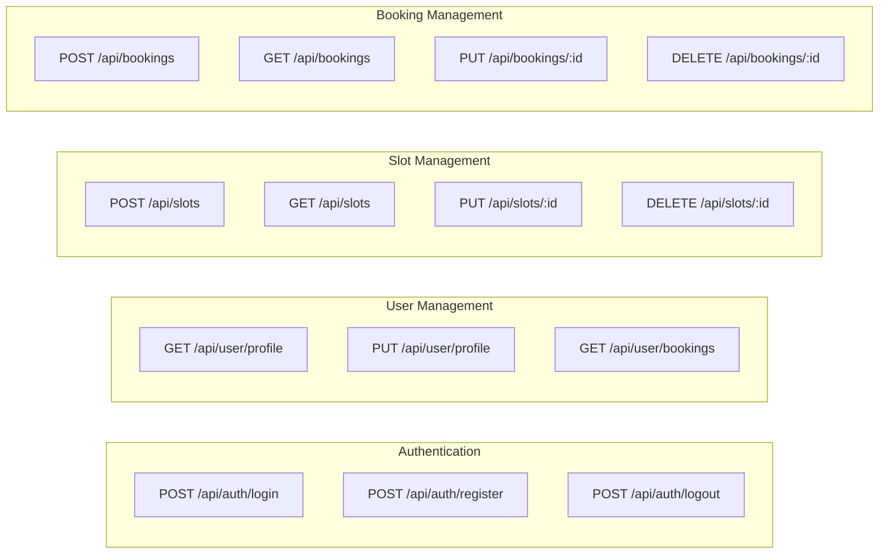

### State Machine for Booking Process
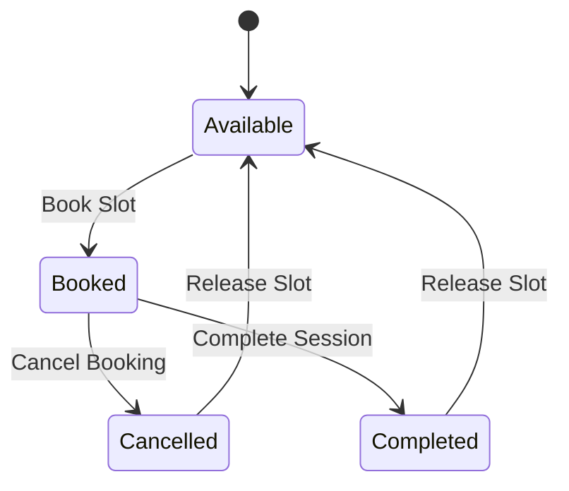

### Component Details

#### Frontend Components
- **Authentication Components**
  - LoginForm
  - RegisterForm
  - PasswordResetForm

- **Dashboard Components**
  - StudentDashboard
  - MentorDashboard
  - StatisticsWidget
  - UpcomingSlotsList

- **Slot Management Components**
  - SlotCreationForm
  - SlotCalendar
  - TimeSlotSelector
  - BookingSummary

#### Backend Services
- **Authentication Service**
  - User authentication
  - Session management
  - Password hashing
  - JWT token generation

- **Slot Management Service**
  - Slot creation
  - Slot availability checking
  - Recurring slot handling
  - Slot updates and deletion

- **Booking Service**
  - Booking creation
  - Booking validation
  - Booking cancellation
  - Booking status updates

- **Notification Service**
  - Email notifications
  - In-app notifications
  - Booking reminders
  - Status updates

#### Database Indexes
- Users: sap_id, email
- Slots: mentor_id, date, start_time
- Bookings: slot_id, student_id, status

#### Caching Strategy
- User profile data
- Available slots
- Booking status
- Department list

#### Security Measures
- Password hashing (bcrypt)
- JWT authentication
- CSRF protection
- Rate limiting
- Input validation
- XSS prevention 

## Database Flow

### User Registration Flow
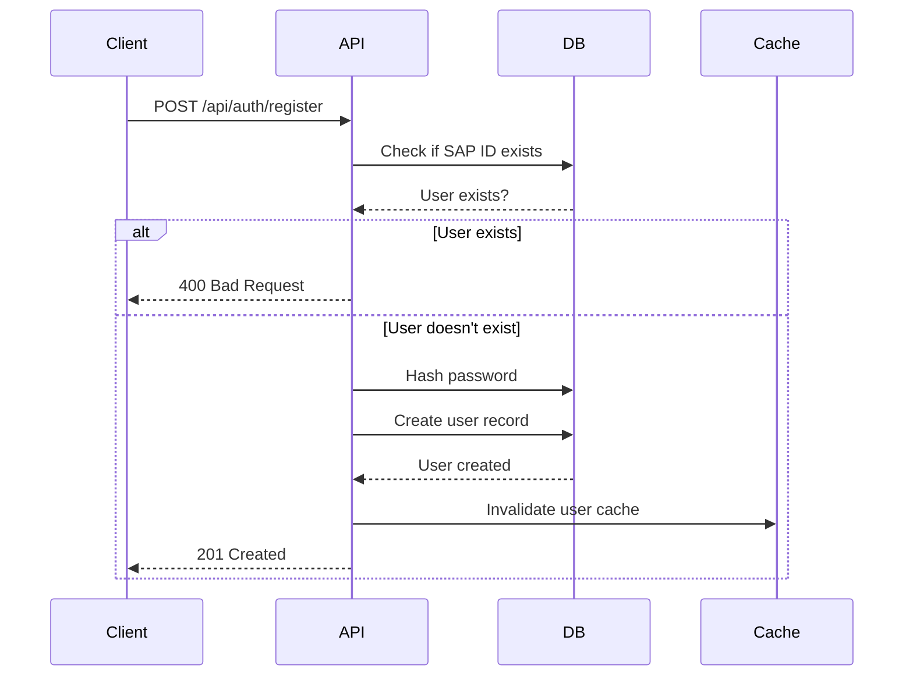

### Slot Creation Flow
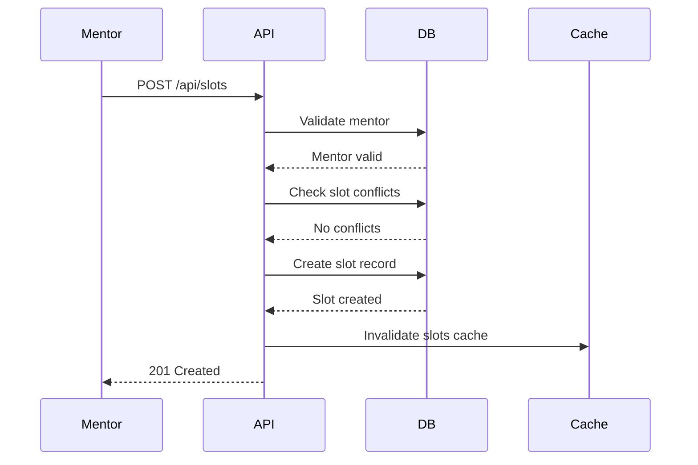

### Booking Flow
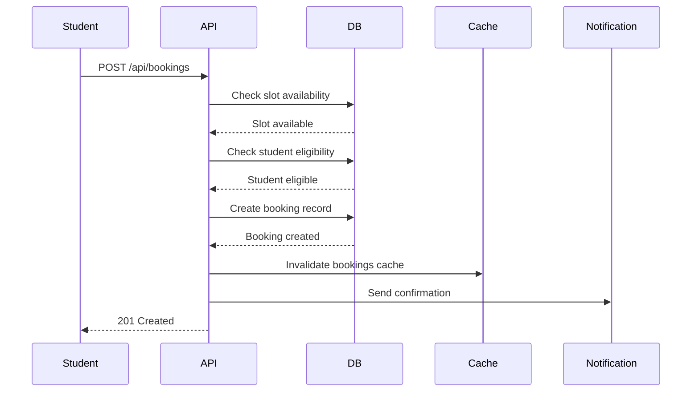

## API Flow

### Authentication Flow
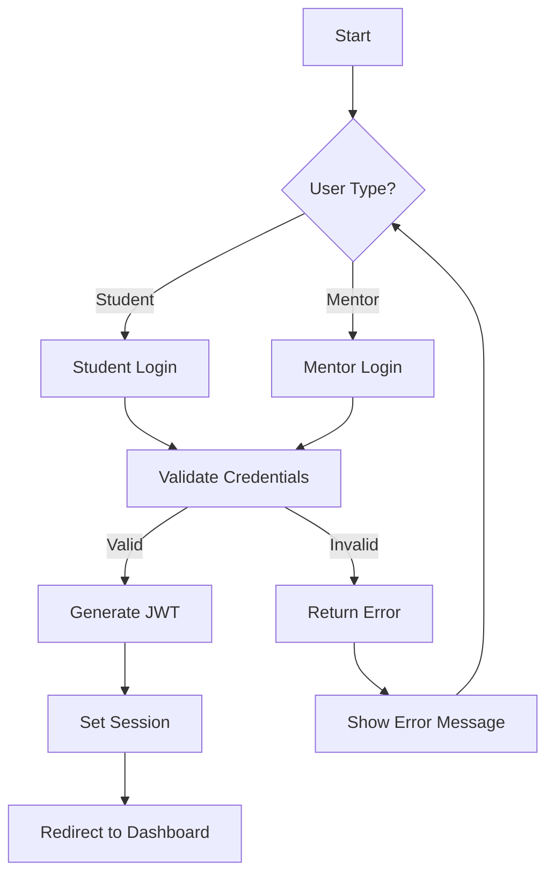

### Slot Management Flow
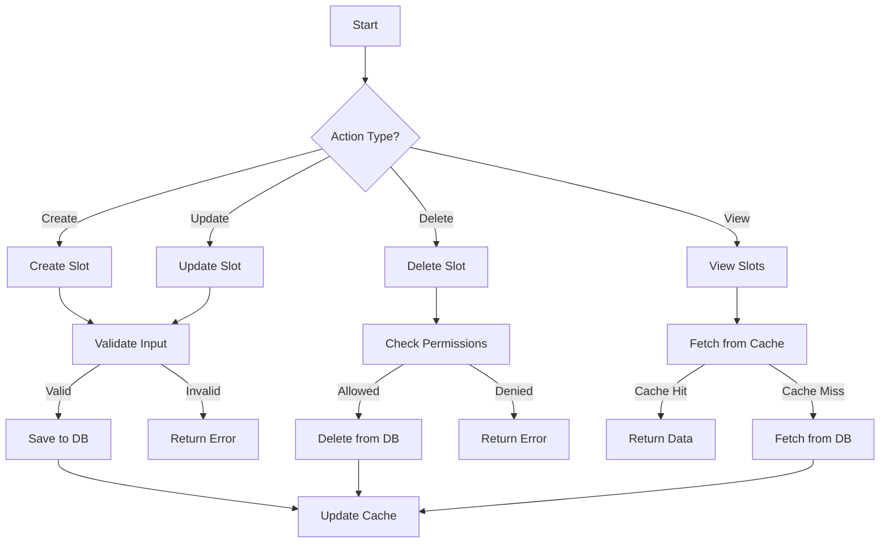

### Booking Management Flow
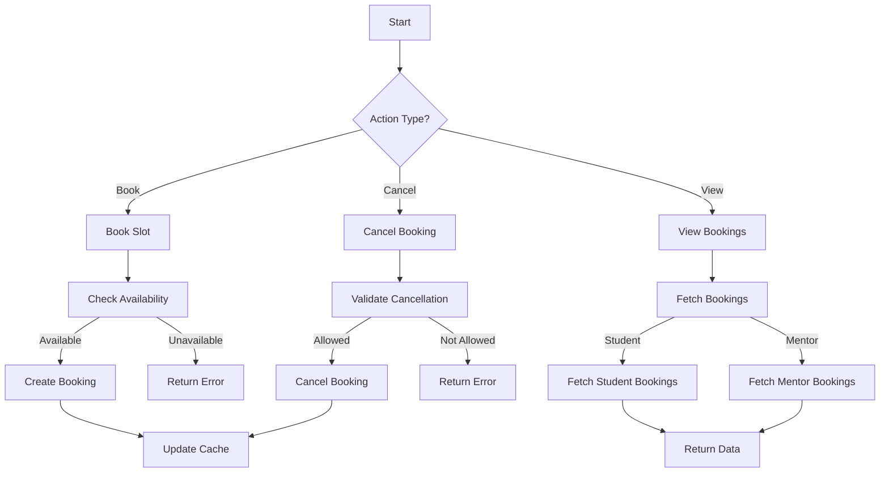

### Data Flow Between Services
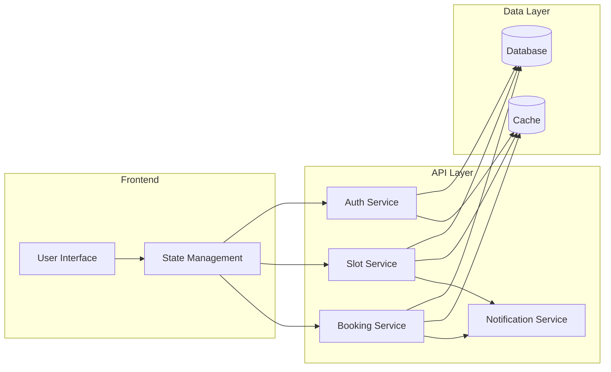

### Error Handling Flow
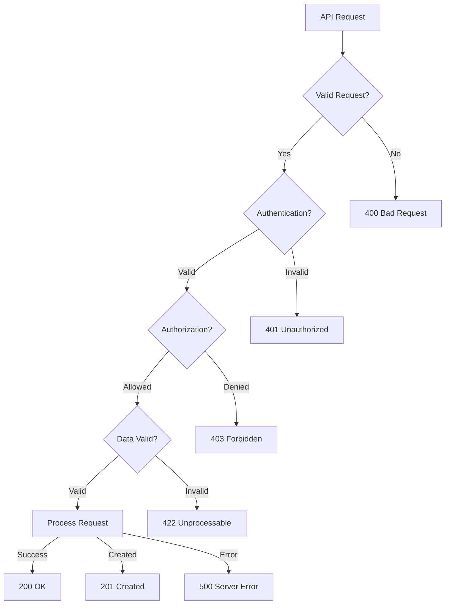

### Cache Invalidation Flow
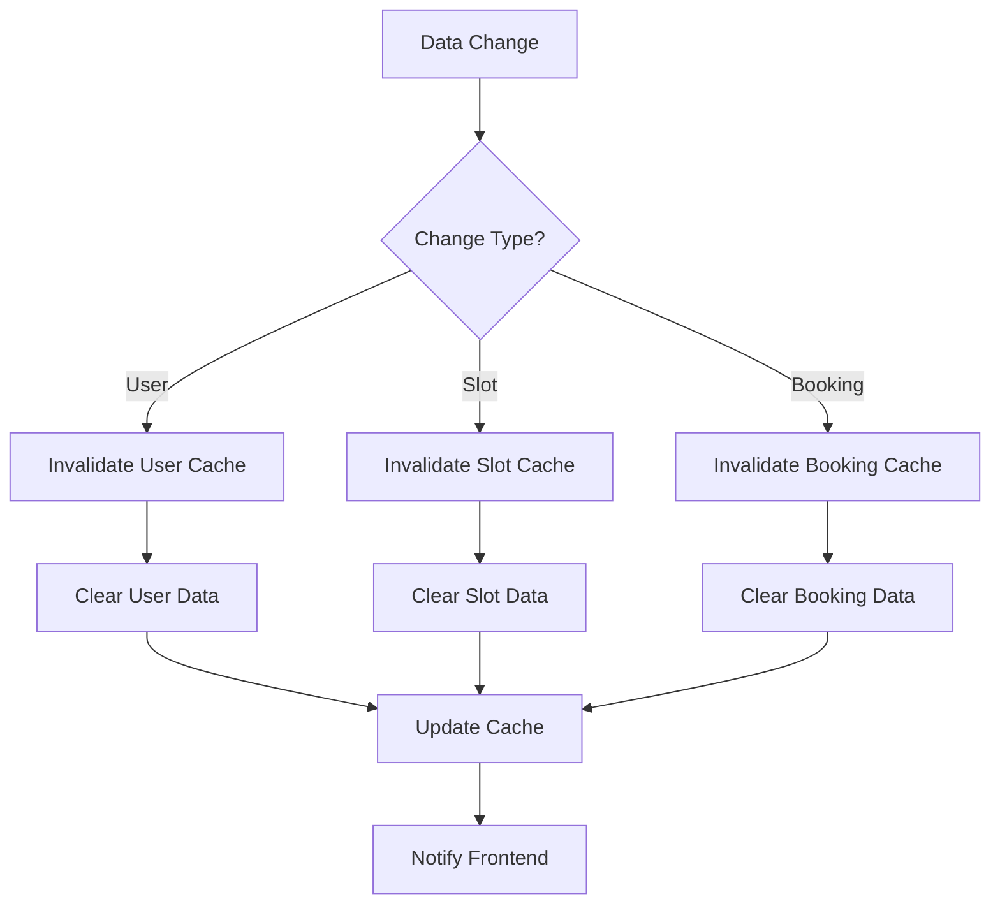